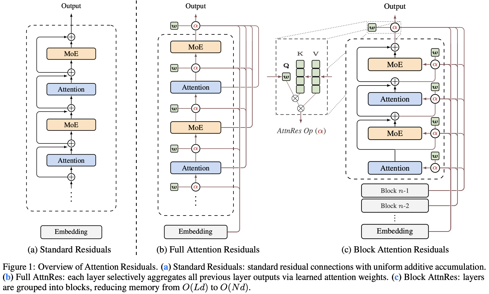
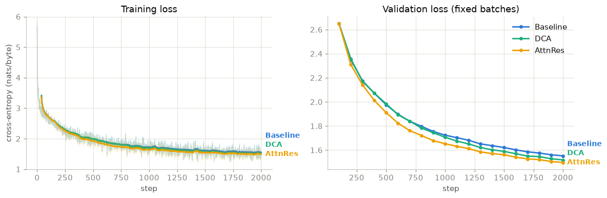
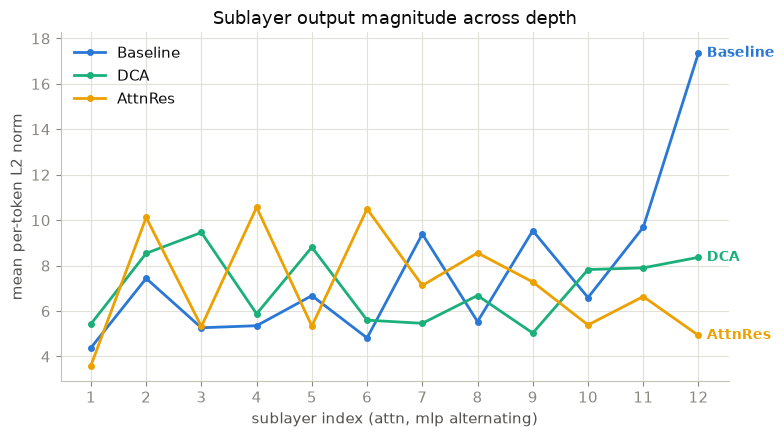
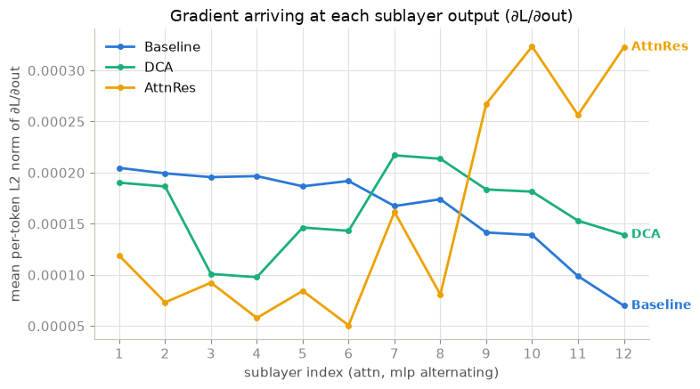
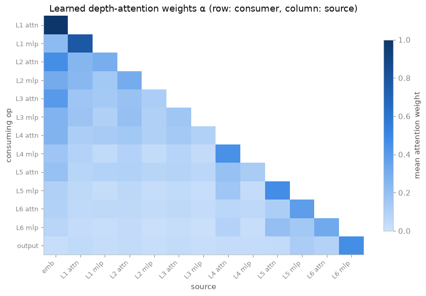

# Attention Residuals at Toy Scale: What Reproduces and What Doesn't

*A from-scratch implementation of Attention Residuals (Kimi Team 2026), trained against DeepCrossAttention (Heddes et al., ICML 2025) and standard PreNorm residuals on enwik8.*

**TL;DR.** This is a from-scratch implementation of Full Attention Residuals (AttnRes) on a ~19M-parameter byte-level GPT, trained alongside two baselines with identical backbone, seed and batch order. Three of the paper's four claims reproduce at this scale: AttnRes trains stably with slightly lower loss, keeps sublayer output magnitudes bounded across depth, and learns the depth-attention patterns the paper reports. The fourth does not: AttnRes produces the *least* uniform gradient distribution across depth of the three models, not the most. Everything is in one self-contained notebook, [`notebook.ipynb`](./notebook.ipynb).

## Motivation

A standard PreNorm transformer forms each layer's input by adding every earlier layer's output onto one running stream, all with a fixed weight of 1:

```math
h \leftarrow h + f(h)
```

The Kimi Team argue that this fixed accumulation has a cost. Because the stream is never rescaled, its magnitude grows with depth, and a deep layer has to emit an ever-larger output to change it noticeably. They call this *PreNorm dilution*.

## Method: attending over depth



*Figure 1 of Kimi Team 2026. (a) Standard residuals. (b) Full AttnRes, implemented here. (c) Block AttnRes, the memory-efficient variant for large-scale training.*

AttnRes replaces the sum with softmax attention along the depth axis. Write $v_0$ for the token embedding and $v_i$ for the output of sublayer $i$. Each sublayer $l$ forms its input as

```math
k_i = \mathrm{RMSNorm}(v_i) \qquad \alpha_{i \to l} = \underset{i \lt l}{\mathrm{softmax}}\;(w_l^\top k_i) \qquad h_l = \sum_{i \lt l} \alpha_{i \to l}\, v_i
```

Three details matter:

- **The query $w_l$ is a learned vector**, not a projection of the input. That costs one `dim`-sized vector (plus a key norm) per sublayer: 13,312 parameters in total here, about 0.07% of the model.
- **$w_l$ starts at zero**, so the softmax starts uniform and training begins from an equal-weight average of the past outputs.
- **Only the keys are normalized.** A large-magnitude output cannot win attention mass through its magnitude alone, but the value that gets mixed in is still the raw $v_i$.

Since the weights sum to 1, every layer input is a convex combination of what came before. The unbounded accumulation is gone, and so is the identity path. That second fact turns out to matter for the gradient result below.

The implementation here is **Full** AttnRes (attention over every sublayer), not the paper's **Block** AttnRes. Block AttnRes exists to save memory and pipeline communication at large scale, where layer outputs must be explicitly kept and shipped between devices. At this scale those outputs are already held for backpropagation, so Full AttnRes costs nothing extra and measures the mechanism without the block approximation.

## Setup

Three models, identical except for the residual rule:

| Variant | Weights over past outputs | Sources it can see | Identity path |
|---|---|---|---|
| **Baseline** | fixed at 1 | the accumulated stream | yes |
| **DCA** | input-dependent, ReLU-gated (GRN), separately per Q/K/V | first 2 + last 2 layers | near-identity at init |
| **AttnRes** | input-dependent softmax, sums to 1 | all past sublayers + embedding | no |

Each model has dim 512, depth 6, 8 heads, sequence length 512, and ~19.2M parameters. All three train for 2,000 steps of batch size 8 on enwik8 (90M bytes train, 5M validation) with Adam at 1e-4 and gradient clipping at 0.5, seed 42, on a single CUDA GPU. The Baseline and AttnRes share the attention and feed-forward modules verbatim.

## Results

### 1. Loss: AttnRes is ahead, but the gap is small



| Variant | Val loss (nats/byte) | Bits/byte | Wall-clock |
|---|---|---|---|
| Baseline | 1.554 ± 0.080 | 2.241 | 38 s |
| DCA | 1.522 ± 0.077 | 2.196 | 86 s |
| AttnRes | **1.499 ± 0.079** | **2.162** | 57 s |

*Mean ± std across 64 fixed validation batches.*

AttnRes separates from the other two early and stays ahead. The ordering matches the paper, but with one seed and a spread across batches larger than the gaps, the defensible claim is "trains stably with comparable loss." AttnRes is also 1.5× slower per step than the baseline here, so it wins per step, not per second.

### 2. Output magnitudes: bounded, as predicted



The baseline's sublayer outputs grow from ~4 to ~17 across the 12 sublayers, with a jump at the last one. AttnRes stays in a band between ~4 and ~11 and ends near where it started. This is the cleanest reproduction in the notebook, because it follows directly from the update rule: a convex combination cannot grow the way a sum does.

### 3. Gradients across depth: does not reproduce



The paper's Fig. 5c shows the baseline concentrating gradient in its earliest layers and AttnRes spreading it evenly. The plot shows the gradient arriving at each sublayer's output, $\partial L / \partial \text{out}$, measured via backward hooks.

The baseline does show the paper's tilt, mildly: largest at the bottom and falling ~2.9× toward the top. AttnRes does not flatten this. It inverts it: smallest at the early sublayers, largest at the deepest, with a ~6.3× spread, the widest of the three. DCA lands in between at ~2.2×.

The most likely explanation is depth. AttnRes has no identity path, so the gradient reaches an early layer only through softmax weights that are split across a growing number of sources. Each step backward attenuates the gradient instead of passing it through. At depth 6 this outweighs any equalizing effect. The paper measures at depth 27 and with *Block* AttnRes, which resets accumulation at block boundaries, so the two setups are not directly comparable. The notebook also reports per-block parameter-gradient norms (flat for the baseline, rising ~5× for AttnRes) and explains why the two probes disagree for the baseline.

### 4. Learned depth attention: matches the paper's Fig. 8



Rows are the consuming sublayers, columns the sources. All three patterns from the paper's §5.4.2 appear:

- **Locality.** Each `mlp` row puts most of its weight on its own block's attention output, the diagonal just left of it.
- **Embedding persistence.** The `emb` column keeps real weight several layers in.
- **Specialization.** Pre-MLP inputs focus on the most recent output; pre-attention inputs spread wider and lean on the embedding.

This is the most like-for-like comparison in the notebook, since the top row of the paper's Fig. 8 is also Full AttnRes.

## Limitations

Single seed. ~19M parameters and ~8M tokens, against the paper's multi-billion-parameter, trillion-token runs. Depth 6 against 27, and depth is the axis the gradient claim depends on. Full AttnRes against the paper's headline Block AttnRes. The structural claims (2 and 4) are the ones a toy model can test, and those hold.

## Running it

```bash
uv sync
uv run jupyter lab notebook.ipynb
```

The notebook downloads enwik8 (~35 MB) into `data/` on first run. Set `QUICK = True` in the configuration cell for a smoke test that runs every cell in a couple of minutes. The full run is sized for a single GPU.

## Credits

The shared GPT backbone, the DCA baseline and the training loop are adapted from Phil Wang's (lucidrains) [`deep-cross-attention`](https://github.com/lucidrains/deep-cross-attention), MIT-licensed (Copyright © 2025 Phil Wang); the enwik8 archive is fetched from the same repository. The AttnRes implementation is my own. Architecture figure from Kimi Team 2026.

## License

[MIT](LICENSE). The license file carries both copyright notices: mine for the AttnRes implementation and the analysis, and Phil Wang's for the parts adapted from `deep-cross-attention`. The architecture figure and the papers in `related_works/` belong to their authors and are not covered by this license.

## References

- Kimi Team (2026). *Attention Residuals* (Technical Report). https://github.com/MoonshotAI/Attention-Residuals
- Heddes, M., Javanmard, A., Axiotis, K., Fu, G., Bateni, M. H., Mirrokni, V. (2025). *DeepCrossAttention: Supercharging Transformer Residual Connections.* ICML 2025. [arXiv:2502.06785](https://arxiv.org/abs/2502.06785).
